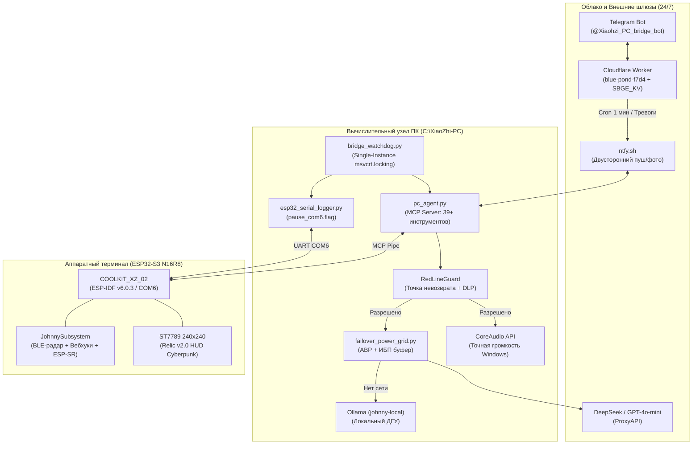

# Архитектура проекта XiaoZhi-PC («Энграмма Джонни Сильверхенда»)
**Версия:** 4.0-alpha (Защита RedLineGuard + CoreAudio + Сборка ESP-IDF v6.0.3) -> 4.0 (Прошивка ESP32-S3 и Голос)  
**Автор:** Курчицикий М.С (fseven89) | **Лицензия:** MIT (LICENSE)

## 1. Диаграмма топологии системы (Гибридная СБГЭ 24/7)

## 2. Основные контуры и компоненты
* **Аппаратный терминал:** XiaoZhi AI (`ESP32-S3 N16R8`, `COOLKIT_XZ_02`, профиль `nologo/xingzhi-cube-1.54tft-wifi`, 1.54" ST7789, Simplex, `COM6` -> `logs/esp32_live.log`).
* **Бесплатный облачный узел (Cloudflare 24/7):** Worker `blue-pond-f7d4.justmiker.workers.dev` + KV (`SBGE_KV`) + Cron (1 мин) — приём пульса `/sbge-heartbeat`, тревоги в `ntfy.sh` при потере связи >2 мин и HTTPS-шлюз без VPN для Telegram Bot API.
* **Двусторонний шлюз и Vision AI (`ntfy_inbox_listener.py` + `vision_inbox.py`):** Приём фото/файлов со смартфона Poco F7 через `ntfy` (`..._in`), Telegram (`@Xiaohzi_PC_bridge_bot`) и локальный Wi-Fi (`:8787`) с мультимодальным разбором.
* **Домашний вычислительный узел (`C:\XiaoZhi-PC`):** `bridge_watchdog.py` (атомарный замок `msvcrt.locking`), `mcp_pipe.py`, `pc_agent.py` (39+ MCP-инструментов), `redline_guard.py` (защита от точки невозврата и DLP-фильтр), ИТ-СБГЭ (`failover_power_grid.py`), аналитика (`system_analytics.py`).
* **Контейнеры Docker (WSL2):** `xiaozhi-homeassistant` (`:8123`), `xiaozhi-docker-sandbox`, сборочный образ `espressif/idf:release-v6.0` (ESP-IDF v6.0.3) и спящий задел под VPS (`CLOUD_DEPLOY.md`).

## 3. Дорожная карта на Этап v4.0+
* **[v4.0 — Самообучение и Энергоэффективность]:** Модуль рефлексии ошибок `self_learning_engine.py`, датчик батареи ноутбука с авто-переводом в энергосбережение.
* **[v4.0 — Прошивка ESP32-S3]:** Симуляция в QEMU (`esp32s3`), слово активации «Джонни» (ESP-SR), палитра LVGL Cyberpunk 2077 («Relic v2.0» + умный ШИМ подсветки `GPIO_NUM_13`), встроенная C++ подсистема `JohnnySubsystem`.
* **[v4.0 — Живой голос]:** Офлайн-движок Silero TTS и клонирование голоса Ильи Бледного (FishSpeech / F5-TTS).
