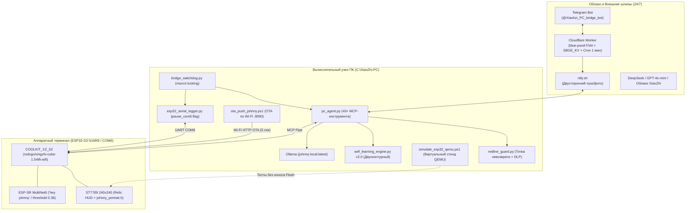

# МАСТЕР-АРХИВ ПРОЕКТА XIAOZHI-PC («ЭНГРАММА ДЖОННИ СИЛЬВЕРХЕНДА»)
**Дата выгрузки:** 2026-11-25 16:24:53 | **Статус:** `v4.0-rc6` | **Локация:** Сестрорецк / СПб

---

## 1. АРХИТЕКТУРА И СХЕМА ВЗАИМОДЕЙСТВИЯ КОНТУРОВ



---

## 2. АППАРАТНЫЕ ТТХ И РАСПИНОВКА (`COOLKIT_XZ_02`)
* **MCU:** `ESP32-S3-WROOM-1 (N16R8)` — 240 МГц Dual-Core, **16 МБ Flash**, **8 МБ Octal PSRAM**, свободная SRAM в работе ~152 КБ.
* **Дисплей 1.54" ST7789 (240×240, SPI):** `MOSI=GPIO10`, `CLK=GPIO9`, `DC=GPIO8`, `CS=GPIO14`, `RST=GPIO18`, `BL(PWM)=GPIO13`.
* **Аудио I2S Simplex:**
  * Микрофон (RX, 16 кГц): `WS=GPIO4`, `SCK=GPIO5`, `DIN=GPIO6`.
  * Динамик (TX, 24 кГц, громкость `85%`): `DOUT=GPIO7`, `BCLK=GPIO15`, `LRCK=GPIO16`.
* **Кнопки:** `BOOT=GPIO0`, `VOL+=GPIO40`, `VOL-=GPIO39`.
* **Свободные GPIO для расширения:** `GPIO1..3` (ADC1), `GPIO11..12` (UART под мм-радар LD2410B), `GPIO17, 21, 38, 41, 42, 47, 48`.
* **Заводской 16-МБ бэкап:** `C:\XiaoZhi-PC\firmware-backup\factory_16mb_backup.bin` | **Откат:** `restore_factory_fw.ps1`.

---

## 3. ПОЛНАЯ СТРУКТУРА ФАЙЛОВ ПРОЕКТА

- **C:\XiaoZhi-PC**
  - `.env` (1206 B)
  - `.env.example` (752 B)
  - `.gitignore` (147 B)
  - `ARCHITECTURE.md` (4341 B)
  - `CHANGELOG.md` (6844 B)
  - `CLOUD_DEPLOY.md` (955 B)
  - `Dockerfile` (394 B)
  - `Dockerfile.cloud` (348 B)
  - `HARDWARE_PASSPORT.md` (6536 B)
  - `LICENSE` (1202 B)
  - `MODERNIZATION_ROADMAP_V4.md` (8070 B)
  - `NEXT_SESSION_PLAN.md` (2967 B)
  - `README.md` (1331 B)
  - `bridge_watchdog.py` (2575 B)
  - `cloud_sentinel.py` (2403 B)
  - `docker-compose.cloud.yml` (308 B)
  - `docker-compose.yml` (1033 B)
  - `esp32_serial_logger.py` (1572 B)
  - `failover_power_grid.py` (7598 B)
  - `mcp_pipe.py` (3641 B)
  - `ntfy_inbox_listener.py` (9495 B)
  - `ota_push_johnny.ps1` (1801 B)
  - `pc_agent.py` (65154 B)
  - `pytest.ini` (31 B)
  - `redline_guard.py` (5200 B)
  - `restore_factory_fw.ps1` (813 B)
  - `self_learning_engine.py` (6962 B)
  - `simulate_esp32_qemu.ps1` (2189 B)
  - `state.json` (27 B)
  - `stress_test_johnny.py` (7193 B)
  - `system_analytics.py` (4320 B)
  - `vision_inbox.py` (4173 B)
  - **.vscode/**
    - `settings.json` (44 B)
  - **backups/**
    - `arch_backup_20261125_101058.zip` (1619 B)
    - `armor_patch_20261124_215820.zip` (28818 B)
    - `backup_20261125_100803_pre_write.zip` (1146768 B)
    - `backup_20261125_101215_pre_write.zip` (1147251 B)
    - `backup_20261125_101540_pre_write.zip` (1148583 B)
    - `backup_20261125_101805_pre_write.zip` (1149795 B)
    - `backup_20261125_143504_pre_write.zip` (1149893 B)
    - `backup_20261125_144120_pre_ps.zip` (1149902 B)
    - `backup_20261125_144123_pre_ps.zip` (1149902 B)
    - `backup_20261125_144230_pre_ps.zip` (1149902 B)
    - `backup_20261125_144742_pre_write.zip` (1150125 B)
    - `backup_20261125_144936_pre_write.zip` (1150871 B)
    - `backup_20261125_152739_pre_write.zip` (1150871 B)
    - `backup_20261125_152920_pre_write.zip` (1153766 B)
    - `backup_20261125_153028_pre_ps.zip` (1154910 B)
    - `backup_20261125_153029_pre_ps.zip` (1154910 B)
    - `backup_20261125_153031_pre_ps.zip` (1154910 B)
    - `backup_20261125_153033_pre_ps.zip` (1154910 B)
    - `backup_20261125_153239_pre_write.zip` (1154910 B)
    - `backup_20261125_153323_pre_ps.zip` (1155993 B)
    - `backup_20261125_153332_pre_write.zip` (1155993 B)
    - `backup_20261125_153459_pre_write.zip` (1158170 B)
    - `board_pre_final_v4_20261125_114150.zip` (6234 B)
    - `board_xingzhi_backup_20261125_111105.zip` (4954 B)
    - `checkpoint_pre_stress_20261125_101537.zip` (92167 B)
    - `checkpoint_v4_rc6_20261125_162331.zip` (66784 B)
    - `modernization_ideas_20261125_015333.zip` (50364 B)
    - `pre_hud_bat_percent_20261125_145509.zip` (12007 B)
    - `pre_johnny_portrait_20261125_153954.zip` (12193 B)
    - `pre_pc_tts_doc_fix_20261125_144934.zip` (17368 B)
    - `pre_redline_agent_20261125_100758.zip` (16783 B)
    - `pre_relic_hud_v2_20261125_132153.zip` (13317 B)
    - `pre_relic_v3_20261125_133723.zip` (12162 B)
    - `pre_self_learning_20261125_101211.zip` (16112 B)
    - `pre_sle_v2_20261125_144739.zip` (6926 B)
    - `pre_v4_sanitize_20261124_215431.zip` (63023 B)
    - `scripts_build_custom_ww_20261125_123409.zip` (18802 B)
    - `scripts_build_py_20261125_121125.zip` (18802 B)
    - `session_checkpoint_20261125_015058.zip` (43094 B)
    - `session_v4_beta_20261125_141847.zip` (61676 B)
    - `v39996_ready_for_v4_firmware.zip` (17723899 B)
    - `v4_0_rc5_cloud_sbge_and_vision_complete.zip` (19003178 B)
  - **firmware-backup/**
    - `factory_16mb_backup.bin` (16777216 B)
  - **ha-config/**
    - `.HA_VERSION` (9 B)
    - `.ha_run.lock` (84 B)
    - `automations.yaml` (2 B)
    - `configuration.yaml` (265 B)
    - `home-assistant.log` (1850 B)
    - `home-assistant.log.1` (1181 B)
    - `home-assistant.log.fault` (0 B)
    - `home-assistant_v2.db` (23662592 B)
    - `home-assistant_v2.db-shm` (32768 B)
    - `home-assistant_v2.db-wal` (4140632 B)
    - `scenes.yaml` (0 B)
    - `scripts.yaml` (0 B)
    - `secrets.yaml` (161 B)
    - **.cache/**
      - **brands/**
        - **integrations/**
    - **.cloud/**
    - **.storage/**
      - `assist_pipeline.pipelines` (634 B)
      - `auth` (3776 B)
      - `auth_provider.homeassistant` (269 B)
      - `bluetooth.passive_update_processor` (101 B)
      - `core.analytics` (348 B)
      - `core.area_registry` (2414 B)
      - `core.config` (413 B)
      - `core.config_entries` (6442 B)
      - `core.device_registry` (11906 B)
      - `core.entity_registry` (98293 B)
      - `core.restore_state` (43219 B)
      - `core.uuid` (126 B)
      - `frontend.system_data` (201 B)
      - `homeassistant.exposed_entities` (586 B)
      - `http` (507 B)
      - `http.auth` (134 B)
      - `lovelace.map` (154 B)
      - `lovelace_dashboards` (323 B)
      - `marketplace.common` (215 B)
      - `marketplace.critical` (282 B)
      - `marketplace.repositories` (4309042 B)
      - `onboarding` (174 B)
      - `person` (286 B)
      - `repairs.issue_registry` (109 B)
      - `trace.saved_traces` (85 B)
      - **sonoff/**
        - `justmiker@gmail.com.json` (5592 B)
      - **xiaomi_miot/**
        - `auth-1630593266-cn.json` (577 B)
        - `devices-1630593266-cn.json` (8084 B)
        - `instances.json` (8286565 B)
        - `urnmiot-spec-v2devicefish-tank0000A0A2hfjh-m1003.json` (31618 B)
        - `urnmiot-spec-v2devicemassager0000A08317216-d1521.json` (2170 B)
        - `urnmiot-spec-v2devicevacuum0000A006viomi-v72.json` (5472 B)
        - `urnmiot-spec-v2devicewatch0000A07Chmpace-v71.json` (1982 B)
        - **spec-langs/**
          - `urnmiot-spec-v2devicefish-tank0000A0A2hfjh-m1003.json` (16942 B)
          - `urnmiot-spec-v2devicemassager0000A08317216-d1521.json` (293 B)
          - `urnmiot-spec-v2devicevacuum0000A006viomi-v72.json` (3174 B)
          - `urnmiot-spec-v2devicewatch0000A07Chmpace-v71.json` (799 B)
    - **blueprints/**
      - **automation/**
        - **homeassistant/**
          - `motion_light.yaml` (1518 B)
          - `notify_leaving_zone.yaml` (1668 B)
      - **script/**
        - **homeassistant/**
          - `confirmable_notification.yaml` (2593 B)
    - **custom_components/**
      - **sonoff/**
        - `__init__.py` (11248 B)
        - `alarm_control_panel.py` (2372 B)
        - `binary_sensor.py` (6071 B)
        - `button.py` (2932 B)
        - `climate.py` (15580 B)
        - `config_flow.py` (5030 B)
        - `cover.py` (10492 B)
        - `diagnostics.py` (2576 B)
        - `fan.py` (8288 B)
        - `light.py` (45532 B)
        - `manifest.json` (356 B)
        - `media_player.py` (3213 B)
        - `number.py` (3890 B)
        - `remote.py` (6799 B)
        - `select.py` (3267 B)
        - `sensor.py` (19462 B)
        - `services.yaml` (295 B)
        - `switch.py` (7288 B)
        - `system_health.py` (4352 B)
        - **core/**
          - `const.py` (375 B)
          - `devices.py` (32210 B)
          - `entity.py` (5240 B)
          - `xutils.py` (1882 B)
        - **translations/**
          - `ar.json` (1270 B)
          - `bg.json` (1602 B)
          - `ee.json` (990 B)
          - `el.json` (1634 B)
          - `en.json` (1043 B)
          - `es.json` (1064 B)
          - `fr-ca.json` (1051 B)
          - `he.json` (1273 B)
          - `hu.json` (1140 B)
          - `id.json` (1021 B)
          - `it.json` (1160 B)
          - `pl.json` (1137 B)
          - `pt-BR.json` (1130 B)
          - `pt.json` (1159 B)
          - `ru.json` (1327 B)
          - `sk.json` (1179 B)
          - `tr.json` (1066 B)
          - `uk.json` (1374 B)
          - `ur.json` (1229 B)
          - `zh-Hant.json` (969 B)
      - **xiaomi_home/**
        - `__init__.py` (19695 B)
        - `binary_sensor.py` (4407 B)
        - `button.py` (3996 B)
        - `climate.py` (33347 B)
        - `config_flow.py` (98423 B)
        - `cover.py` (14937 B)
        - `device_tracker.py` (5620 B)
        - `event.py` (4269 B)
        - `fan.py` (13817 B)
        - `humidifier.py` (9541 B)
        - `light.py` (12207 B)
        - `manifest.json` (738 B)
        - `media_player.py` (20026 B)
        - `notify.py` (7092 B)
        - `number.py` (4750 B)
        - `select.py` (4345 B)
        - `sensor.py` (6183 B)
        - `switch.py` (4564 B)
        - `text.py` (8216 B)
        - `vacuum.py` (13668 B)
        - `water_heater.py` (9169 B)
        - **brand/**
          - `icon.png` (4851 B)
        - **miot/**
          - `common.py` (7756 B)
          - `const.py` (6251 B)
          - `miot_client.py` (87214 B)
          - `miot_cloud.py` (34457 B)
          - `miot_device.py` (63474 B)
          - `miot_error.py` (4665 B)
          - `miot_i18n.py` (4661 B)
          - `miot_lan.py` (51807 B)
          - `miot_mdns.py` (10666 B)
          - `miot_mips.py` (60306 B)
          - `miot_network.py` (14559 B)
          - `miot_spec.py` (65463 B)
          - `miot_storage.py` (31203 B)
          - `web_pages.py` (3508 B)
        - **translations/**
          - `de.json` (28506 B)
          - `en.json` (25035 B)
          - `es.json` (29153 B)
          - `fr.json` (29501 B)
          - `it.json` (28370 B)
          - `ja.json` (31857 B)
          - `nl.json` (26584 B)
          - `pt-BR.json` (27325 B)
          - `pt.json` (27402 B)
          - `ru.json` (41982 B)
          - `tr.json` (26957 B)
          - `zh-Hans.json` (22059 B)
          - `zh-Hant.json` (21925 B)
      - **xiaomi_miot/**
        - `__init__.py` (50150 B)
        - `alarm_control_panel.py` (5127 B)
        - `binary_sensor.py` (14680 B)
        - `button.py` (2806 B)
        - `camera.py` (27587 B)
        - `climate.py` (24407 B)
        - `config_flow.py` (54989 B)
        - `cover.py` (10744 B)
        - `device_tracker.py` (7809 B)
        - `fan.py` (12443 B)
        - `humidifier.py` (5841 B)
        - `icons.json` (1086 B)
        - `intent.py` (5078 B)
        - `light.py` (8689 B)
        - `manifest.json` (527 B)
        - `media_player.py` (42632 B)
        - `number.py` (2954 B)
        - `pkg.zip` (355442 B)
        - `remote.py` (9690 B)
        - `select.py` (3853 B)
        - `sensor.py` (31729 B)
        - `services.yaml` (7329 B)
        - `switch.py` (2477 B)
        - `system_health.py` (1379 B)
        - `text.py` (3367 B)
        - `time.py` (1384 B)
        - `vacuum.py` (16525 B)
        - `water_heater.py` (7972 B)
        - **brand/**
          - `icon.png` (2302 B)
          - `icon@2x.png` (3392 B)
          - `logo.png` (14340 B)
          - `logo@2x.png` (43435 B)
        - **core/**
          - `__init__.py` (216 B)
          - `const.py` (1639 B)
          - `converters.py` (11576 B)
          - `coord_transform.py` (3891 B)
          - `coordinator.py` (2015 B)
          - `device.py` (67683 B)
          - `device_customizes.py` (174527 B)
          - `hass_entity.py` (12609 B)
          - `hass_entry.py` (7241 B)
          - `miio2miot.py` (11627 B)
          - `miio2miot_specs.py` (133611 B)
          - `mini_miio.py` (12571 B)
          - `miot_local_devices.py` (29960 B)
          - `miot_spec.py` (42809 B)
          - `miot_specs_extend.json` (60652 B)
          - `templates.py` (17777 B)
          - `translation_languages.py` (96544 B)
          - `utils.py` (13949 B)
          - `xiaomi_cloud.py` (51667 B)
        - **scripts/**
          - `save_xiaomi_video.sh` (751 B)
        - **translations/**
          - `cs.json` (10178 B)
          - `de.json` (10650 B)
          - `el.json` (14741 B)
          - `en.json` (25388 B)
          - `es.json` (14169 B)
          - `fr.json` (10826 B)
          - `hu.json` (15842 B)
          - `it.json` (20561 B)
          - `ko.json` (23059 B)
          - `pl.json` (10563 B)
          - `pt-BR.json` (20656 B)
          - `ru.json` (13049 B)
          - `tr.json` (22736 B)
          - `uk.json` (27355 B)
          - `vi.json` (23139 B)
          - `zh-Hans.json` (23648 B)
          - `zh-Hant.json` (22148 B)
    - **tts/**
    - **www/**
  - **logs/**
    - `ai_decisions_audit.jsonl` (52077 B)
    - `esp32_crash_hunt.log` (3903 B)
    - `esp32_live.log` (3407635 B)
    - `esp32_serial.log` (167 B)
    - `johnny_audit.jsonl` (267673 B)
    - `sbge_failover_audit.jsonl` (1899 B)
    - `tg_owner_id.txt` (9 B)
    - `ups_task_buffer.json` (4288 B)
    - `watchdog.lock` (5 B)
    - `watchdog.pid` (5 B)
  - **tests/**
    - `test_pc_agent.py` (1561 B)
    - `test_redline_guard.py` (1402 B)
    - `test_self_learning.py` (1093 B)
  - **vpn-config/**
    - `config.json` (222 B)
    - `config.json.bak` (225 B)
  - **workspace/**
    - `.gitignore` (200 B)
    - `STRESS_TEST_REPORT.md` (1489 B)
    - `SetVolume10Percent.ps1` (1935 B)
    - `ai_comparison.md` (9689 B)
    - `ai_comparison_report.md` (1980 B)
    - `calc.py` (5838 B)
    - `cloud_response.md` (4349 B)
    - `crash_analysis_20261124.md` (5232 B)
    - `crash_анализ.md` (5635 B)
    - `diagnostika_proekta_johnny.md` (6332 B)
    - `docker_audit_report_2026-11-22.md` (5596 B)
    - `full_diagnostics_2026-11-25.md` (3934 B)
    - `garage_offline_note.md` (1483 B)
    - `hud_bugs_notes.md` (1914 B)
    - `hud_render_analysis.md` (7192 B)
    - `johnny_improvement_plan.md` (3990 B)
    - `johnny_optimization_vision.md` (5349 B)
    - `johnny_project_analysis_report.md` (5826 B)
    - `johnny_project_full_analysis.md` (7641 B)
    - `last_file_analysis.md` (1497 B)
    - `last_vision_analysis.md` (2145 B)
    - `lessons_learned.json` (8298 B)
    - `local_ai_test.md` (648 B)
    - `local_response.md` (2012 B)
    - `notes.md` (8583 B)
    - `project_history.md` (6227 B)
    - `query` (13 B)
    - `set_volume.ps1` (1013 B)
    - `snake.py` (4471 B)
    - `snake_8bit.py` (0 B)
    - `snake_game.py` (2323 B)
    - `virtual_device_idea.md` (1873 B)
    - `план_устранения_сбоев.md` (7551 B)
    - **inbox/**
      - `20261124_190755_note.txt` (12 B)
      - `20261124_191132_note.txt` (2 B)
      - `20261124_204803_note.txt` (9 B)
      - `20261124_204959_Screenshot_2026-11-24-20-44-02-533_org.telegram.messenger.jpg` (1122009 B)
      - `20261124_205545_note.txt` (135 B)
  - **xiaozhi-esp32/**
    - `.clang-format` (3462 B)
    - `.dockerignore` (194 B)
    - `.gitignore` (259 B)
    - `AGENTS.md` (4959 B)
    - `CMakeLists.txt` (507 B)
    - `LICENSE` (1162 B)
    - `README.md` (11086 B)
    - `README_ja.md` (12723 B)
    - `README_zh.md` (10652 B)
    - `dependencies.lock` (34522 B)
    - `sdkconfig` (137012 B)
    - `sdkconfig.defaults` (2287 B)
    - `sdkconfig.defaults.esp32` (131 B)
    - `sdkconfig.defaults.esp32c3` (398 B)
    - `sdkconfig.defaults.esp32c5` (266 B)
    - `sdkconfig.defaults.esp32c6` (101 B)
    - `sdkconfig.defaults.esp32p4` (704 B)
    - `sdkconfig.defaults.esp32s3` (1406 B)
    - `sdkconfig.defaults.esp32s31` (670 B)
    - `sdkconfig.old` (131295 B)
    - **.github/**
      - `SUPPORT.md` (2898 B)
      - **ISSUE_TEMPLATE/**
        - `01_build_flash_bug.yml` (2756 B)
        - `02_runtime_bug.yml` (2989 B)
        - `03_feature_request.yml` (1621 B)
        - `04_board_support_request.yml` (2238 B)
        - `05_technical_question.yml` (1655 B)
        - `config.yml` (559 B)
      - **workflows/**
        - `build.yml` (3769 B)
        - `release.yml` (4368 B)
        - `test-mcp.yml` (923 B)
    - **docker/**
      - **firmware-builder/**
        - `Dockerfile` (1219 B)
        - `README.md` (3388 B)
        - `entrypoint.sh` (360 B)
        - `firmware_builder.py` (16300 B)
        - `test_firmware_builder.py` (14046 B)
    - **docs/**
      - `audio-codec-input-audit.md` (23556 B)
      - `blufi.md` (2851 B)
      - `blufi_zh.md` (2529 B)
      - `code_style.md` (4347 B)
      - `code_style_zh.md` (3538 B)
      - `custom-board.md` (21199 B)
      - `custom-board_zh.md` (17650 B)
      - `glyph-push.md` (7637 B)
      - `glyph-push_zh.md` (6831 B)
      - `mcp-based-graph.jpg` (97848 B)
      - `mcp-protocol.md` (19672 B)
      - `mcp-protocol_zh.md` (18345 B)
      - `mcp-usage.md` (6778 B)
      - `mcp-usage_zh.md` (3831 B)
      - `mqtt-udp-probe.md` (27030 B)
      - `mqtt-udp-probe_zh.md` (23015 B)
      - `mqtt-udp.md` (10645 B)
      - `mqtt-udp_zh.md` (9872 B)
      - `notify.md` (5249 B)
      - `ota.md` (13465 B)
      - `ota_zh.md` (12452 B)
      - `releasing.md` (3152 B)
      - `websocket.md` (18785 B)
      - `websocket_zh.md` (18524 B)
      - **v0/**
        - `AtomMatrix-echo-base.jpg` (37326 B)
        - `ESP32-BreadBoard.jpg` (96480 B)
        - `atoms3r-echo-base.jpg` (25250 B)
        - `esp32s3-box3.jpg` (17509 B)
        - `lichuang-s3.jpg` (20482 B)
        - `m5stack-cores3.jpg` (19191 B)
        - `magiclick-2p4.jpg` (11988 B)
        - `waveshare-esp32-s3-touch-amoled-1.8.jpg` (47563 B)
        - `wiring.jpg` (124026 B)
      - **v1/**
        - `atoms3r.jpg` (28224 B)
        - `electron-bot.png` (21247 B)
        - `esp-hi.jpg` (17933 B)
        - `esp-sparkbot.jpg` (36275 B)
        - `espbox3.jpg` (31581 B)
        - `lichuang-s3.jpg` (39732 B)
        - `lilygo-t-circle-s3.jpg` (48137 B)
        - `m5cores3.jpg` (23993 B)
        - `magiclick.jpg` (44916 B)
        - `movecall-cuican-esp32s3.jpg` (50781 B)
        - `movecall-moji-esp32s3.jpg` (46522 B)
        - `otto-robot.png` (27392 B)
        - `sensecap_watcher.jpg` (39233 B)
        - `waveshare.jpg` (23034 B)
        - `wiring2.jpg` (58797 B)
        - `wmnologo_xingzhi_0.96.jpg` (24754 B)
        - `wmnologo_xingzhi_1.54.jpg` (52550 B)
        - `xmini-c3.jpg` (30530 B)
    - **main/**
      - `CMakeLists.txt` (75135 B)
      - `Kconfig.projbuild` (50059 B)
      - `application.cc` (58384 B)
      - `application.h` (7236 B)
      - `assets.cc` (26754 B)
      - `assets.h` (3351 B)
      - `cjson_utils.h` (571 B)
      - `device_state.h` (445 B)
      - `device_state_machine.cc` (5387 B)
      - `device_state_machine.h` (2366 B)
      - `idf_component.yml` (4952 B)
      - `main.cc` (827 B)
      - `mcp_server.cc` (35105 B)
      - `mcp_server.h` (20685 B)
      - `ota.cc` (21448 B)
      - `ota.h` (2287 B)
      - `sdkconfig.rename` (366 B)
      - `settings.cc` (3053 B)
      - `settings.h` (820 B)
      - `system_info.cc` (5136 B)
      - `system_info.h` (602 B)
      - **assets/**
        - `lang_config.h` (11823 B)
        - **common/**
          - `exclamation.ogg` (1663 B)
          - `low_battery.ogg` (2269 B)
          - `popup.ogg` (1148 B)
          - `success.ogg` (2012 B)
          - `vibration.ogg` (1574 B)
        - **locales/**
      - **audio/**
        - `README.md` (5539 B)
        - `audio_codec.cc` (1705 B)
        - `audio_codec.h` (2411 B)
        - `audio_debugger.cc` (2735 B)
        - `audio_debugger.h` (371 B)
        - `audio_engine.h` (1402 B)
        - `audio_service.cc` (36049 B)
        - `audio_service.h` (9121 B)
        - `fixed_queue.h` (1840 B)
        - `wake_word.h` (833 B)
        - **codecs/**
          - `box_audio_codec.cc` (9394 B)
          - `box_audio_codec.h` (1730 B)
          - `dummy_audio_codec.cc` (495 B)
          - `dummy_audio_codec.h` (421 B)
          - `es8311_audio_codec.cc` (7345 B)
          - `es8311_audio_codec.h` (1507 B)
          - `es8374_audio_codec.cc` (6780 B)
          - `es8374_audio_codec.h` (1449 B)
          - `es8388_audio_codec.cc` (8207 B)
          - `es8388_audio_codec.h` (1474 B)
          - `es8389_audio_codec.cc` (8561 B)
          - `es8389_audio_codec.h` (1539 B)
          - `no_audio_codec.cc` (13824 B)
          - `no_audio_codec.h` (1784 B)
        - **demuxer/**
          - `ogg_demuxer.cc` (16779 B)
          - `ogg_demuxer.h` (2245 B)
        - **engines/**
          - `afe_audio_engine.cc` (25187 B)
          - `afe_audio_engine.h` (4408 B)
          - `lite_audio_engine.cc` (6036 B)
          - `lite_audio_engine.h` (2424 B)
        - **wake_words/**
          - `custom_wake_word.cc` (12828 B)
          - `custom_wake_word.h` (2389 B)
          - `esp_wake_word.cc` (4225 B)
          - `esp_wake_word.h` (1378 B)
          - `wake_word_audio_cache.cc` (2930 B)
          - `wake_word_audio_cache.h` (755 B)
      - **boards/**
        - **alientek/**
        - **bread-compact-esp32/**
          - `README.md` (303 B)
          - `config.h` (1492 B)
          - `config.json` (424 B)
          - `esp32_bread_board.cc` (5563 B)
        - **bread-compact-esp32-lcd/**
          - `config.h` (8243 B)
          - `config.json` (266 B)
          - `esp32_bread_board_lcd.cc` (7397 B)
        - **bread-compact-ml307/**
          - `compact_ml307_board.cc` (6710 B)
          - `config.h` (1485 B)
          - `config.json` (426 B)
        - **bread-compact-nt26/**
          - `compact_nt26_board.cc` (6575 B)
          - `config.h` (1641 B)
          - `config.json` (252 B)
        - **bread-compact-wifi/**
          - `compact_wifi_board.cc` (6363 B)
          - `config.h` (1492 B)
          - `config.json` (423 B)
        - **bread-compact-wifi-lcd/**
          - `compact_wifi_board_lcd.cc` (6556 B)
          - `config.h` (8579 B)
          - `config.json` (261 B)
        - **bread-compact-wifi-s3cam/**
          - `README.md` (602 B)
          - `compact_wifi_board_s3cam.cc` (7990 B)
          - `config.h` (9203 B)
          - `config.json` (394 B)
        - **chd/**
        - **common/**
          - `adc_battery_monitor.cc` (3931 B)
          - `adc_battery_monitor.h` (888 B)
          - `axp2101.cc` (2671 B)
          - `axp2101.h` (582 B)
          - `backlight.cc` (3639 B)
          - `backlight.h` (830 B)
          - `blufi.cpp` (42035 B)
          - `blufi.h` (5158 B)
          - `board.cc` (8006 B)
          - `board.h` (3455 B)
          - `button.cc` (4028 B)
          - `button.h` (1451 B)
          - `camera.h` (835 B)
          - `dual_network_board.cc` (3276 B)
          - `dual_network_board.h` (1947 B)
          - `esp32_camera.cc` (11560 B)
          - `esp32_camera.h` (1488 B)
          - `esp_video.cc` (45163 B)
          - `esp_video.h` (2205 B)
          - `ethernet_board.cc` (10826 B)
          - `ethernet_board.h` (1467 B)
          - `i2c_device.cc` (1691 B)
          - `i2c_device.h` (594 B)
          - `knob.cc` (1460 B)
          - `knob.h` (490 B)
          - `lamp_controller.h` (1555 B)
          - `ml307_board.cc` (9571 B)
          - `ml307_board.h` (1264 B)
          - `nt26_board.cc` (10949 B)
          - `nt26_board.h` (2082 B)
          - `power_save_timer.cc` (6940 B)
          - `power_save_timer.h` (1679 B)
          - `press_to_talk_mcp_tool.cc` (1910 B)
          - `press_to_talk_mcp_tool.h` (712 B)
          - `rndis_board.cc` (8327 B)
          - `rndis_board.h` (2322 B)
          - `sleep_timer.cc` (4827 B)
          - `sleep_timer.h` (881 B)
          - `sy6970.cc` (1760 B)
          - `sy6970.h` (423 B)
          - `system_reset.cc` (2229 B)
          - `system_reset.h` (429 B)
          - `wifi_board.cc` (11996 B)
          - `wifi_board.h` (1994 B)
          - `xpower.h` (3604 B)
        - **cyberai/**
        - **dfrobot/**
        - **doit-s3-aibox/**
          - `README.md` (625 B)
          - `config.h` (850 B)
          - `config.json` (194 B)
          - `doit_s3_aibox.cc` (4220 B)
        - **du-chatx/**
          - `config.h` (1230 B)
          - `config.json` (170 B)
          - `du-chatx-wifi.cc` (6152 B)
          - `power_manager.h` (6193 B)
        - **electron-bot/**
          - `README.md` (7299 B)
          - `config.h` (1477 B)
          - `config.json` (239 B)
          - `electron_bot.cc` (5512 B)
          - `electron_bot_controller.cc` (31353 B)
          - `electron_emoji_display.cc` (3521 B)
          - `electron_emoji_display.h` (658 B)
          - `movements.cc` (19326 B)
          - `movements.h` (2691 B)
          - `oscillator.cc` (4018 B)
          - `oscillator.h` (2650 B)
          - `otto_icon_font.c` (4441 B)
          - `power_manager.h` (4322 B)
          - `websocket_control_server.cc` (7232 B)
          - `websocket_control_server.h` (789 B)
        - **espressif/**
        - **folotoy/**
        - **freenove-esp32s3-display-2.8-lcd/**
          - `ReadMe.md` (379 B)
          - `config.h` (1709 B)
          - `config.json` (183 B)
          - `freenove-esp32s3-display-2.8-lcd.cc` (7942 B)
        - **genjutech-s3-1.54tft/**
          - `config.h` (1264 B)
          - `config.json` (194 B)
          - `genjutech-s3-1.54tft.cc` (9777 B)
          - `power_manager.h` (6193 B)
        - **guition/**
        - **hu-087/**
          - `README.md` (427 B)
          - `config.h` (752 B)
          - `config.json` (168 B)
          - `hu_087_board.cc` (5337 B)
        - **jiuchuan-s3/**
          - `README.md` (1454 B)
          - `config.h` (1484 B)
          - `config.json` (176 B)
          - `esp_lcd_panel_gc9301.c` (17612 B)
          - `esp_lcd_panel_gc9301.h` (851 B)
          - `gpio_manager.h` (1967 B)
          - `jiuchuan_dev_board.cc` (15500 B)
          - `power_controller.h` (1534 B)
          - `power_manager.h` (7040 B)
        - **kevin/**
        - **labplus/**
        - **lc-s3-wifi-1.54tft/**
          - `README.md` (535 B)
          - `config.h` (1435 B)
          - `config.json` (190 B)
          - `lc-s3-wifi-1.54tft.cc` (8493 B)
          - `power_manager.h` (6177 B)
        - **lcdwiki-es3c35p/**
          - `README.md` (4891 B)
          - `config.h` (1738 B)
          - `config.json` (149 B)
          - `lcdwiki-es3c35p.cc` (15508 B)
        - **lceda-course-examples/**
        - **lckfb/**
        - **lilygo/**
        - **m5stack/**
        - **magiclick/**
        - **maza-ai/**
        - **minsi-k08-dual/**
          - `README.md` (829 B)
          - `config.h` (1432 B)
          - `config.json` (182 B)
          - `minsi_k08_dual.cc` (9093 B)
          - `power_manager.h` (6232 B)
        - **mixgo-nova/**
          - `README.md` (1625 B)
          - `config.h` (1472 B)
          - `config.json` (418 B)
          - `mixgo-nova.cc` (6033 B)
        - **movecall/**
        - **nologo/**
        - **nulllab-ai-vox-v3/**
          - `README.md` (2611 B)
          - `ai_vox3_audio_codec.h` (9542 B)
          - `ai_vox3_board.cc` (7477 B)
          - `config.h` (1580 B)
          - `config.json` (191 B)
          - `power_manager.h` (5017 B)
        - **otto-robot/**
          - `README.md` (17600 B)
          - `config.h` (5229 B)
          - `config.json` (492 B)
          - `oscillator.cc` (4496 B)
          - `oscillator.h` (3025 B)
          - `otto_controller.cc` (53004 B)
          - `otto_emoji_display.cc` (5706 B)
          - `otto_emoji_display.h` (1067 B)
          - `otto_icon_font.c` (4441 B)
          - `otto_movements.cc` (34931 B)
          - `otto_movements.h` (4281 B)
          - `otto_robot.cc` (19744 B)
          - `power_manager.h` (11121 B)
          - `websocket_control_server.cc` (9490 B)
          - `websocket_control_server.h` (1069 B)
        - **quandong/**
        - **rymcu/**
        - **seeed/**
        - **sensecap-watcher/**
          - `README.md` (1459 B)
          - `README_en.md` (1768 B)
          - `config.h` (5206 B)
          - `config.json` (567 B)
          - `sensecap_audio_codec.cc` (7446 B)
          - `sensecap_audio_codec.h` (1475 B)
          - `sensecap_watcher.cc` (27660 B)
          - `sscma_camera.cc` (34876 B)
          - `sscma_camera.h` (2619 B)
        - **spotpear/**
        - **surfer-c3-1.14tft/**
          - `README.md` (236 B)
          - `config.h` (1341 B)
          - `config.json` (355 B)
          - `power_manager.h` (6695 B)
          - `surfer-c3-1.14tft.cc` (7600 B)
        - **taiji-pi-s3/**
          - `README.md` (936 B)
          - `config.h` (2634 B)
          - `config.json` (521 B)
          - `taiji_pi_s3.cc` (25990 B)
        - **waveshare/**
        - **wdmomo/**
        - **wk-esp32s3-dev/**
          - `README.md` (1161 B)
          - `config.h` (12003 B)
          - `config.json` (147 B)
          - `esp_lcd_ili9486.c` (14974 B)
          - `esp_lcd_ili9486.h` (3997 B)
          - `esp_lcd_nv3030b.c` (14607 B)
          - `esp_lcd_nv3030b.h` (3922 B)
          - `wk-esp32s3-dev.cc` (11779 B)
        - **xmini/**
        - **xorigin/**
        - **yunliao-s3/**
          - `README.md` (3124 B)
          - `config.h` (2080 B)
          - `config.json` (231 B)
          - `power_manager.cc` (8172 B)
          - `power_manager.h` (1293 B)
          - `yunliao_s3.cc` (11809 B)
        - **zectrix/**
        - **zhengchen/**
      - **display/**
        - `display.cc` (1589 B)
        - `display.h` (4459 B)
        - `emote_display.cc` (11856 B)
        - `emote_display.h` (1938 B)
        - `johnny_portrait.h` (50205 B)
        - `lcd_display.cc` (65414 B)
        - `lcd_display.h` (3017 B)
        - `lvgl_no_psram_pool.h` (458 B)
        - `lvgl_psram_pool.h` (574 B)
        - `oled_display.cc` (17820 B)
        - `oled_display.h` (1443 B)
        - `text_glyph.cc` (121 B)
        - `text_glyph.h` (1818 B)
        - **epd_display/**
          - `epd_display.cc` (10715 B)
          - `epd_display.h` (2790 B)
          - `epd_display_2_9.cc` (819 B)
          - `epd_display_2_9.h` (457 B)
        - **lvgl_display/**
          - `dynamic_glyph_cache.cc` (6375 B)
          - `dynamic_glyph_cache.h` (1278 B)
          - `emoji_collection.cc` (673 B)
          - `emoji_collection.h` (489 B)
          - `lvgl_display.cc` (13275 B)
          - `lvgl_display.h` (2086 B)
          - `lvgl_font.cc` (263 B)
          - `lvgl_font.h` (1139 B)
          - `lvgl_image.cc` (2059 B)
          - `lvgl_image.h` (1228 B)
          - `lvgl_theme.cc` (1059 B)
          - `lvgl_theme.h` (4634 B)
      - **led/**
        - `circular_strip.cc` (8335 B)
        - `circular_strip.h` (1966 B)
        - `gpio_led.cc` (8399 B)
        - `gpio_led.h` (1383 B)
        - `led.h` (298 B)
        - `single_led.cc` (4619 B)
        - `single_led.h` (978 B)
      - **notify/**
        - `notify_player.cc` (10413 B)
        - `notify_player.h` (1940 B)
      - **protocols/**
        - `mqtt_protocol.cc` (30488 B)
        - `mqtt_protocol.h` (3010 B)
        - `protocol.cc` (4318 B)
        - `protocol.h` (3667 B)
        - `text_glyph_payload.cc` (4535 B)
        - `text_glyph_payload.h` (260 B)
        - `udp_probe.h` (2524 B)
        - `websocket_protocol.cc` (10409 B)
        - `websocket_protocol.h` (885 B)
    - **partitions/**
      - **v1/**
        - `16m.csv` (337 B)
        - `16m_custom_wakeword.csv` (336 B)
        - `16m_echoear.csv` (381 B)
        - `32m.csv` (484 B)
        - `4m.csv` (296 B)
        - `4m_esp-hi.csv` (342 B)
        - `8m.csv` (349 B)
      - **v2/**
        - `16m.csv` (343 B)
        - `16m_c3.csv` (346 B)
        - `32m.csv` (411 B)
        - `4m.csv` (301 B)
        - `8m.csv` (343 B)
        - `README.md` (4299 B)
    - **scripts/**
      - `audio_debug_server.py` (1856 B)
      - `build.py` (77338 B)
      - `build_default_assets.py` (45552 B)
      - `download_github_runs.py` (9234 B)
      - `gen_lang.py` (7207 B)
      - `mp3_to_ogg.sh` (137 B)
      - `publish_firmware.py` (11892 B)
      - `release.py` (344 B)
      - `versions.py` (8844 B)
      - **Image_Converter/**
        - `LVGLImage.py` (47612 B)
        - `README.md` (1120 B)
        - `lvgl_tools_gui.py` (11256 B)
        - `requirements.txt` (49 B)
      - **ci/**
        - `blufi.sdkconfig.defaults` (82 B)
        - `representative-variants.json` (3233 B)
      - **ogg_converter/**
        - `README.md` (1035 B)
        - `xiaozhi_ogg_converter.py` (9895 B)
      - **p3_tools/**
        - `README.md` (2354 B)
        - `batch_convert_gui.py` (9541 B)
        - `convert_audio_to_p3.py` (2847 B)
        - `convert_p3_to_audio.py` (1446 B)
        - `p3_gui_player.py` (8686 B)
        - `play_p3.py` (2142 B)
        - `requirements.txt` (120 B)
        - **img/**
          - `img.png` (144945 B)
      - **spiffs_assets/**
        - `README.md` (3201 B)
        - `build.py` (14396 B)
        - `build_all.py` (4766 B)
        - `pack_model.py` (4064 B)
        - `spiffs_assets_gen.py` (23857 B)
      - **tests/**
        - `test_assets.py` (20002 B)
        - `test_build.py` (83247 B)
        - `test_build_default_assets.py` (12924 B)
        - `test_camera_orientation.py` (4816 B)
        - `test_ci_selection.py` (11274 B)
        - `test_esp32_camera_upload.py` (6882 B)
        - `test_esp_hi_emotion_routing.py` (3234 B)
        - `test_esp_vocat_i2c.py` (6001 B)
        - `test_gif_open.py` (7173 B)
        - `test_jpeg_fit_scale.py` (4014 B)
        - `test_lcd_emotion_visibility.py` (8680 B)
        - `test_mcp_server.py` (29183 B)
        - `test_ogg_demuxer.py` (7231 B)
        - `test_ota_url_fallback.py` (2671 B)
        - `test_power_save_timer.py` (15226 B)
        - `test_protocol_capabilities.py` (8047 B)
        - `test_publish_firmware.py` (10854 B)
        - `test_rgb_matrix_emotion.py` (4212 B)
        - `test_spiffs_assets.py` (3340 B)
        - `test_startup_assets.py` (10889 B)
        - `test_startup_wake_word_hint.py` (17787 B)
        - `test_udp_probe.py` (26726 B)

---

## 4. ЧТО УЖЕ РЕАЛИЗОВАНО И ПРОТЕСТИРОВАНО (`v4.0-rc6`)
1. **Защита от крашей и утечек (`redline_guard.py`):** перехват деструктивных команд ОС/проекта с 4-значным кодом подтверждения (TTL 90с) + DLP-фильтр исходящего трафика. Исправлено ложное срабатывание на `Format-Table`.
2. **Двухконтурное самообучение (`self_learning_engine.py` v2.0):** анализ сбоев из `johnny_audit.jsonl` и живых диалогов из `esp32_live.log` (`workspace/lessons_learned.json`).
3. **Энергоэффективность и управление ПК:** нативный CoreAudio API (`set_system_volume_percent`), контроль батареи ноутбука (`check_laptop_power_eco`), энерготаймер колонки `15s / 90s` (`PowerSaveTimer(-1, 15, 90)`), NVS Anti-Bootloop.
4. **Инфраструктура без износа флеш-памяти:**
   * Виртуальный стенд **`simulate_esp32_qemu.ps1`** (эмуляция ESP32-S3 + 8 МБ PSRAM в Docker).
   * OTA-обновлятор по Wi-Fi **`ota_push_johnny.ps1`** (через встроенный MCP `self.upgrade_firmware` за ~5 сек без кабеля).
5. **Автотесты и стресс-тест:** `12/12` юнит-тестов `pytest` пройдены, `6/6` контуров `stress_test_johnny.py` (`PASS`).

---

## 5. НЕРЕШЁННЫЕ ЗАДАЧИ (БЭКЛОГ НА СЛЕДУЮЩУЮ СЕССИЮ)

### Приоритет 1 — Визуал Энграммы Джонни и стабильность текста на экране ESP32-S3
1. **Перенос HUD и портрета Джонни на системный верхний слой LVGL (`lv_layer_top()`):**
   * *Проблема:* В `LcdDisplay` методы `SetChatMessage()` и `SetStatus()` перерисовывают стандартные контейнеры поверх `screen` и периодически скрывают/затирают текст и элементы HUD.
   * *Решение:* Разместить портрет Джонни Сильверхенда (`johnny_portrait.h`, проверить порядок байт `LV_COLOR_16_SWAP` для SPI ST7789) и цифровой индикатор заряда **`BAT: XX%` / `CHG: XX%`** на `lv_layer_top()`, который LVGL всегда рендерит поверх любых окон.
   * *Доставка:* Обкатать в `simulate_esp32_qemu.ps1` и прошить **по воздуху через `.\ota_push_johnny.ps1`** (без проводов).
2. **Фикс пропадающей строки текста (`SetChatMessage` в `lcd_display.cc`):**
   * Убрать сброс видимости/таймеров прокрутки при переключении состояний `speaking <-> listening`, чтобы текст ответов Джонни всегда оставался читаемым в нижней зоне экрана.

### Приоритет 2 — Живой голос и резервирование от облака
3. **Локальный живой голос Джонни:** развернуть офлайн-TTS (**Silero TTS** или **F5-TTS** / **FishSpeech** на RTX 2060) и подключить к `pc_agent.py`.
4. **Автономный резервный сервер для колонки (WebSocket на ПК `ws://192.168.0.x:8765`):** чтобы при падении интернета или облака XiaoZhi колонка переключалась на локальный Whisper + Ollama (`johnny-local`) + Silero TTS.
5. **Очистка системного промпта в консоли `xiaozhi.me`:** запретить LLM озвучивать вслух технические символы `%` при вызове MCP-инструментов и закрепить характер Джонни Сильверхенда.

### Приоритет 3 — Безопасность, оптимизация и железо (v4.1 — v5.0)
6. **Шифрование секретов:** перенести ключи из открытого `.env` в Windows Credential Manager / DPAPI + добавить AES-256 шифрование облачных бэкапов.
7. **Ротация логов и оптимизация процессов:** добавить ротацию по размеру (`5 МБ`) для `esp32_live.log` (сейчас >44 000 строк) и автопроверку батареи ноутбука в фоне `bridge_watchdog.py`.
8. **Cloudflare Worker (`blue-pond-f7d4`):** добавить защищённый эндпоинт `/esp-push` и `/esp-cmd` (через Secret `X-Johnny-Key`) и дедупликацию тревог СБГЭ в `SBGE_KV`.
9. **Долговременная векторная память (ChromaDB / SQLite-vec)** + проактивные голосовые уведомления («Пульс Джонни»).
10. **Аппаратный мод (по желанию):** динамик 4 Ом / 3–5 Вт с акустической камерой + мм-радар присутствия **HLK-LD2410B** на `GPIO11/12`.

---

## 6. ВЫГРУЗКА УРОКОВ САМООБУЧЕНИЯ (`LESSONS_LEARNED.JSON`)

Всего циклов самообучения: 7 | Правил: 22
- `[auto_13]` ask_local_ollama: Локальный сервер Ollama недоступен (запустите приложение Ollama): HTTPConnectionPool(host= -> Проверить права доступа, таймаут или параметры вызова перед повтором.
- `[auto_14]` run_safe_powershell: Get-ChildItem : Не удается найти путь "C:\heoange-pc", так как он не существует.
строка:1  -> Проверить права доступа, таймаут или параметры вызова перед повтором.
- `[auto_15]` manage_notes: - Создать запрос на получение логов устройства (цифровой энграммы Джонни Сильверхенда) для -> Проверить права доступа, таймаут или параметры вызова перед повтором.
- `[auto_16]` run_safe_powershell: <#
.SYNOPSIS
    Rotates Home Assistant API token and updates .env file
.DESCRIPTION
    T -> Проверить права доступа, таймаут или параметры вызова перед повтором.
- `[auto_17]` run_safe_powershell: C:\XiaoZhi-PC\workspace\rotate_ha_token.ps1:102 знак:29
+                 $newAuth = "$use -> Проверить права доступа, таймаут или параметры вызова перед повтором.
- `[auto_18]` run_safe_powershell: Write-Host "Restoring from backup..." -ForegroundColor Yellow
        Copy-Item -Path $bac -> Проверить права доступа, таймаут или параметры вызова перед повтором.
- `[auto_19]` run_safe_powershell: Copy-Item -Path $backupPath -Destination $configFilePath -Force [71]
        Write-Log "Re -> Проверить права доступа, таймаут или параметры вызова перед повтором.
- `[auto_20]` esp32_audio: Частые прерывания речи (11 раз) -> Повысить порог Wake Word до 0.48 и отключить DETECTION_IN_LISTENING.
- `[auto_21]` speak_johnny_pc: Ошибка озвучки ПК: No audio was received. Please verify that your parameters are correct. -> Проверить права доступа, таймаут или параметры вызова перед повтором.
- `[auto_22]` phone_send_document: Сбой отправки файла: 'latin-1' codec can't encode characters in position 0-6: ordinal not  -> Проверить права доступа, таймаут или параметры вызова перед повтором.

Недавние фразы/замечания из диалогов:
- «Ты можешь отобразить картинку на устройство это твое?»
- «да как же нет ну блин опять ну что такое»
- «ознакомься с проектом на локальном диске c хиоанжи»
- «опять сам себя перебил»
- «сейчас текст ничего не показывает»
- «так а самоанализ у нас работает действует»
- «и обучение самообучение»
- «Запиши влог чат последнего часа.»


---

## 7. ВЫГРУЗКА НАКОПЛЕННЫХ ЗАМЕТОК (`WORKSPACE/NOTES.MD`)

```markdown
- Создать запрос на получение логов устройства (цифровой энграммы Джонни Сильверхенда) для диагностики перезагрузок. Нужно выгрузить внутренние логи системы.
- Решение по перезагрузке ПК (22.11.2026): причина — ошибка 0xFC, конфликт Claude VM Service с Windows Defender при установке Claude из Microsoft Store. Вывод: отключить/придержать автообновление Windows и приложений, ставить обновления вручную. Полностью не выключать — откладывать на срок и обновлять под контролем.
- 8-битная змейка на Python с Pygame - полный код
- БЮДЖЕТНЫЕ МИНИ-ПК С OCULINK (доступные в РФ):

1. GMKtec M7 - Ryzen 7 7840HS/8845HS, Oculink, ~23-27 тыс руб
2. Topfeel мини-хост - Intel i5-8745H, Oculink, ~21-24 тыс руб
3. Minisforum UM780 XTX - Ryzen 7 7840HS, Oculink, ~37 тыс руб
4. Minisforum UM890 Pro - Ryzen 7 8845HS, Oculink, ~73 тыс руб
5. 天钡 MACO-L - Ryzen 7 H255, Oculink, ~40 тыс руб

Где искать: Авито (б/У), Ozon/Wildberries/AliExpress (новые)
Старая SATA HDD: через USB-адаптер или в модели с 2.5" SATA разъемом

Рекомендация для сервера (Docker + Ollama): GMKtec M7 или Minisforum UM780 XTX
- Полная диагностика проекта Джонни: отчёт сохранён в C:\XiaoZhi-PC\workspace\johnny_project_full_analysis.md (5101 байт). Проанализирована структура, интеграции (Home Assistant, ntfy.sh, ESP32), режимы работы, выявлены точки улучшения.
- Анализ проекта Джонни - проблемы: HA_TOKEN и PHONE_NTFY_TOPIC в .env открыты (риск), нет unit-тестов для pc_agent.py, нет E2E-шифрования через ntfy.sh, Entertainment Mode почти пустой, Combat Mode отключает 80% функций. Рекомендации: добавить pytest, внедрить age/Minisign для шифрования, ротация HA_TOKEN, расширить Entertainment Mode с TTS и Spotify API.
- [2026-11-24 11:56] Диагностика систем после смены:
• Локальные системы: CPU 12.1%, RAM 58.2%, диск C 174.5 ГБ свободно — всё в норме
• Docker: xiaozhi-docker-sandbox и xiaozhi-homeassistant работают, xiaozhi-vpn-proxy оффлайн 43 часа
• Сеть: 6 устройств в локалке, роутер 192.168.0.1 отвечает
• Умный дом: робот-пылесос на зарядке (80%), аквариум — низкий уровень воды, насос остановлен, гаражные устройства недоступны
• Облачные сервисы: связь восстановлена, интеграции отвечают
- Анализ системных сбоев Windows (22 ноября):
- 4 BSOD: 0x9f, 0xef, 0x7e - все в combat mode
- 80% сбоев при активной работе Docker
- Конфликт USB-драйвера ESP32-S3 (COM6)
- Пик ошибок: 23:00-00:00 (32%)
- Причины: конфликт ресурсов Ollama+Docker+USB, устаревшие драйверы
- Решения: обновить драйверы, очистить Docker, отключить гибернацию, выделить USB-контроллер для ESP32


## БЭКЛОГ НА ЭТАП v4.0+ (ИДЕИ ДЛЯ РЕАЛИЗАЦИИ)
- [ ] Прошивка ESP32-S3 (`xingzhi-cube-1.54tft-wifi`): слово активации «Джонни» (ESP-SR) + тема Cyberpunk 2077.
- [ ] Встроенная C++ подсистема `JohnnySubsystem` внутри ESP32: экран, Wi-Fi, BLE-радар (Mi Band 10 / Poco F7), прямые вебхуки.
- [ ] Живой голос Джонни: Silero TTS + клонирование голоса Ильи Бледного (FishSpeech / F5-TTS).
- [ ] Home Assistant: отключить 3 шумящих сенсора Xiaomi/старой лампы, проверить воду в аквариуме и питание в гараже.
- [ ] Mi Band 10 + Poco F7: управление домом через MacroDroid + клиент RustDesk на телефон.
- [ ] Безопасность и железо: шифрование бэкапов AES-256, ротация HA_TOKEN, Mini-UPS 12V/5V, перенос 24/7 на мини-ПК или VPS (`CLOUD_DEPLOY.md`).


### [2026-11-24 17:51] ФИНАЛ ПРОГРАММНОЙ БАЗЫ (v3.99.96 — ГОТОВНОСТЬ К ЭТАПУ 4)
- Устранены причины BSOD (0x0A/0x1E/0x3B/0xFC): отключен драйвер rvnetmp60.sys (Radmin VPN), выключен RSC/LSO на WSL2/Wi-Fi, заблокирован сон USB COM6.
- Внедрены контур ИТ-СБГЭ (failover_power_grid.py), облачный задел (cloud_sentinel.py), сводная аналитика (system_analytics.py) и анти-галлюцинатор.
- Зафиксированы авторские права MIT: Курчицикий М.С (fseven89). Весь код забэкаплен и отправлен в GitHub.


### [2026-11-24 21:24] РЕЛИЗ v4.0-rc5 ЗАФИКСИРОВАН И ЗАБЭКАПЛЕН
- Подключен бесплатный облачный сторож СБГЭ 24/7 в Cloudflare Worker (blue-pond-f7d4.justmiker.workers.dev + SBGE_KV + Cron 1 мин).
- Заработал Vision-анализ фото и скриншотов со смартфона через ntfy (..._in), Telegram (@Xiaohzi_PC_bridge_bot) и Wi-Fi (:8787).
- Обновлена полная схема ARCHITECTURE.md. Следующий шаг в новой сессии: прошивка ESP32-S3 (v4.0) и живой голос.


### [2026-11-24 21:26] РЕЛИЗ v4.0-rc5 ЗАФИКСИРОВАН И ЗАБЭКАПЛЕН
- Подключен бесплатный облачный сторож СБГЭ 24/7 в Cloudflare Worker (blue-pond-f7d4.justmiker.workers.dev + SBGE_KV + Cron 1 мин).
- Заработал Vision-анализ фото и скриншотов со смартфона через ntfy (..._in), Telegram (@Xiaohzi_PC_bridge_bot) и Wi-Fi (:8787).
- Обновлена полная схема ARCHITECTURE.md. Следующий шаг в новой сессии: прошивка ESP32-S3 (v4.0) и живой голос.

- Полная дорожная карта модернизации v4.0+ (HUD Cyberpunk 2077, RedLineGuard, QEMU-симуляция, оптимизация и железо) сохранена в `C:\XiaoZhi-PC\MODERNIZATION_ROADMAP_V4.md`.
- Создать стресс-тест системы для анализа производительности и стабильности всех компонентов (ESP32-S3, ПК, нейросети, ИТ-СБГЭ)
- Видение оптимизации проекта сохранено в johnny_optimization_vision.md: критические проблемы с SRAM ESP32-S3, план оптимизации в 3 этапа, стресс-тестирование после внедрения
- ЗАДАЧА: Настроить точное управление громкостью Windows на 10% через PowerShell. Проблема: SendKeys и Windows Audio API не работают в системе. Нужно найти альтернативный метод (nircmd, другая утилита или другой подход).

- [Чекпоинт v4.0-beta] Прошит Relic HUD V3.0 + порог активации 0.48, создан виртуальный стенд QEMU (simulate_esp32_qemu.ps1). Следующий шаг: вывод заряда АКБ в процентах на HUD + живой голос.

- [Чекпоинт v4.0-rc6] Настроен OTA-апдейтер по Wi-Fi (ota_push_johnny.ps1), порог 0.36, 12/12 тестов pytest. В новой сессии: перенос Relic HUD и портрета Джонни на lv_layer_top() + фикс видимости текста + OTA-заливка.
```
